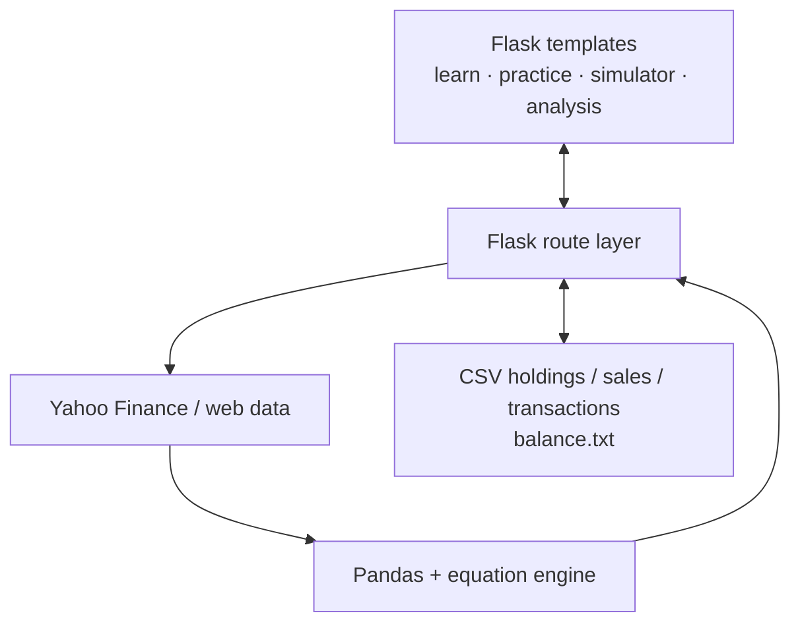

<div align="center">

<sub>Real photography by <a href="https://unsplash.com/photos/financial-stock-market-data-displayed-on-a-screen-EuIqk6LpUU0">Daniel Brzdęk on Unsplash</a>.</sub>

# HedgeX
### Paper trading, quantitative exploration, and market education in one Flask platform.


[Platform](#platform) · [Architecture](#architecture) · [API](#application-surface) · [Setup](#quick-start)
</div>

---

## Overview

HedgeX is a multi-page financial learning and simulation environment built on Flask. It combines virtual cash and holdings, buy/sell workflows, transaction history, live Yahoo Finance context, configurable stock equations, S&P 500 screening, quarterly fundamentals, charts, guided practice, and long-form learning content.

The project deliberately uses transparent flat-file persistence—CSV ledgers and a balance file—so every portfolio mutation can be inspected without a database.

> [!IMPORTANT]
> This is an educational paper-trading application. Market data may be delayed or incomplete, and nothing here is investment advice or a brokerage system.

## Platform

| Area | Capabilities |
|---|---|
| **Portfolio** | $100,000 initial virtual balance, holdings, buys, sells, reset, and updated portfolio views |
| **Transactions** | Append-only trade ledger, balance-after fields, JSON retrieval, CSV download |
| **Market data** | Ticker history, price/volume, quarterly data, trading ranges, and charts via `yfinance` |
| **Analysis** | Custom equation evaluation, available-column discovery, single-ticker and S&P 500 analysis |
| **Simulation** | Historical movement calculations and strategy experimentation |
| **Learning** | Dedicated learn and practice experiences in large, styled HTML templates |

## Architecture



## Application surface

Representative routes include:

| Route | Purpose |
|---|---|
| `/`, `/learn`, `/practice`, `/simulator`, `/analysis` | Main product experiences |
| `/stock`, `/stock_chart`, `/quarterly_data` | Market and financial data |
| `/trade`, `/sell_stock`, `/reset` | Portfolio mutation |
| `/balance`, `/update_holdings`, `/transactions` | Portfolio state retrieval |
| `/evaluate_equation`, `/evaluate_sp500` | Quantitative expression analysis |
| `/available_columns`, `/get_trades` | Analysis and trade metadata |
| `/download_transactions` | Exportable transaction ledger |

## Quick start

```bash
git clone https://github.com/TanishC4444/finalSMGHedgex.git
cd finalSMGHedgex
python -m venv .venv
source .venv/bin/activate
python -m pip install -r requirements.txt
python app.py
```

Open the local Flask URL printed by the application. Data files are initialized on first use where required.

## Repository map

```text
finalSMGHedgex/
├── app.py                    Flask app, portfolio, market APIs
├── templates/
│   ├── main.html
│   ├── analysis.html
│   ├── simulator.html
│   ├── practice.html
│   └── learn.html
├── users.csv                 current holdings
├── sold.csv                  sale state
├── transactions.csv          trade audit trail
├── balance.txt               virtual cash balance
├── requirements.txt
└── test.py                   market-metric experiment
```

## Engineering notes

- Route-level separation exposes a broad web API behind the interactive templates.
- Transactions record the balance after each operation, improving auditability.
- Market-hours logic and Eastern timezone handling align interactions with U.S. markets.
- A file lock/transaction layer is absent; simultaneous writes can corrupt flat-file state.
- User identity and portfolio data are global files rather than isolated authenticated accounts.
- Expression evaluation is a powerful surface and should be strictly sandboxed before public deployment.
- The current `test.py` is an exploratory script, not an automated regression suite.

## Skills demonstrated

Full-stack Flask development · financial data APIs · portfolio accounting · CSV persistence · analytical endpoints · data visualization · responsive product UI · market-domain modeling

## Resume-ready highlight

> Built a full-stack financial learning platform with a $100K paper portfolio, transaction accounting, live market enrichment, quantitative expression screening, S&P 500 analysis, interactive simulation, and multi-page educational UX.

## License

No license file is currently included.

