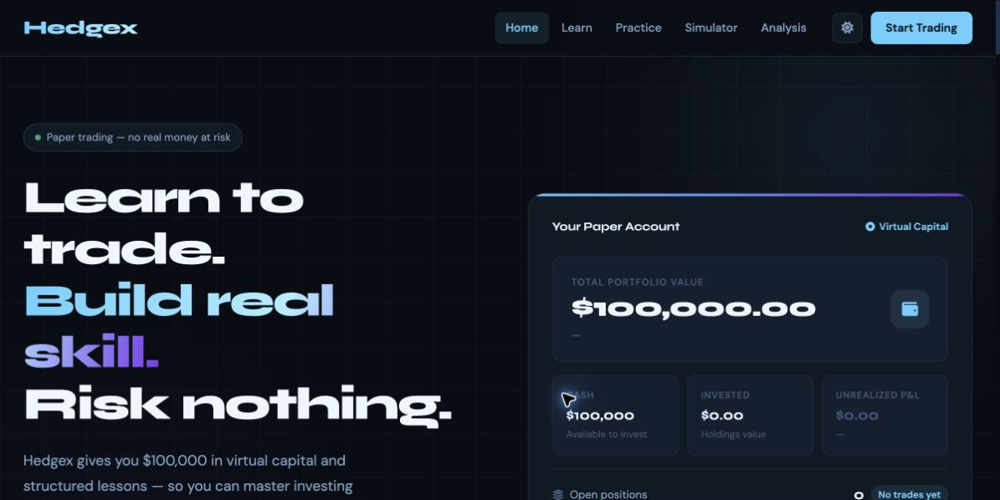

# HedgeX

A local Flask project for paper trading, stock research, strategy exploration,
and investing lessons. Trades use simulated funds; market-data features need
an internet connection.

This is the maintained HedgeX repository. The related
[finalSMGHedgex](https://github.com/TanishC4444/finalSMGHedgex) and
[PCIS_FantasySMG](https://github.com/TanishC4444/PCIS_FantasySMG) repositories
preserve earlier project variants with different code and templates. They are
not interchangeable copies. Eagle Shack is a separate school-store project.

## Run locally

Requires Python 3.10+.

```sh
git clone https://github.com/TanishC4444/Hedgex.git
cd Hedgex
python -m venv .venv
source .venv/bin/activate
python -m pip install -r requirements.txt
python app.py
```

On Windows, activate with `.venv\Scripts\activate`. Open
`http://127.0.0.1:5000`. The old `pip install -r req.txt` command also works.

## What is included

- Flask routes and analysis in `app.py`
- Learning, trading, simulator, and analysis pages under `templates/`
- Local CSV/text files for simulated holdings, transactions, and balance
- [Portfolio analysis](PORTFOLIO_ANALYSIS.md) and example images under `docs/`

## Check the app

```sh
python -m pip install -r requirements-dev.txt
python -m pytest -q
```

The smoke checks cover page rendering, a fresh simulated balance, and input
validation without fetching market data. Live quotes, trading calculations,
and strategy evaluation need separate integration checks.

## Current limits

Run this as a local, single-user prototype. Shared file persistence, formula
evaluation, and missing account isolation need review before public hosting.
The existing CSV files are project state, not a multi-user database. Use copies
or synthetic data for demonstrations. Historical market results do not predict
future outcomes.

[MIT license](LICENSE), consistent with the existing license in the related
finalSMGHedgex project. No code or history was discarded when identifying the
maintained version.


