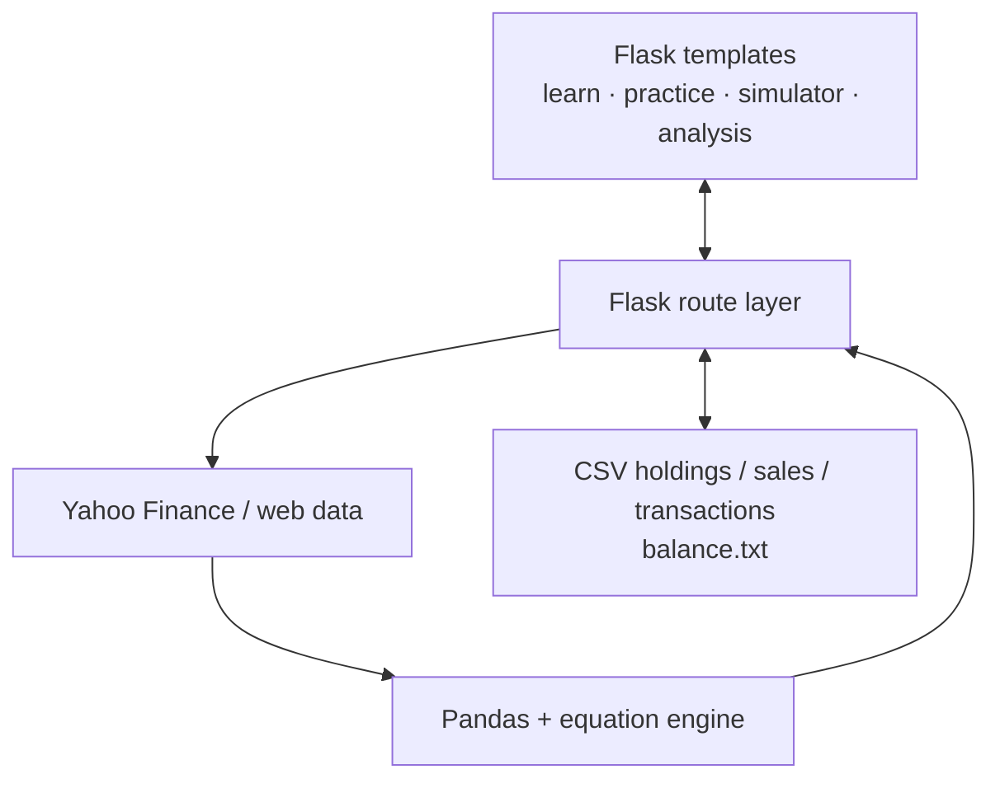

> **Archived duplicate.** Continue in [TanishC4444/Hedgex](https://github.com/TanishC4444/Hedgex). This repository's source branches and release tags are preserved there under `history/finalSMGHedgex/`. The old copy remains available read-only.

> **Earlier HedgeX variant.** Current project maintenance is in
> [Hedgex](https://github.com/TanishC4444/Hedgex). This repository preserves its
> original implementation and project history; code and templates differ between
> variants. Eagle Shack is a separate school-store project.


*Real photography by [Daniel Brzdęk on Unsplash](https://unsplash.com/photos/financial-stock-market-data-displayed-on-a-screen-EuIqk6LpUU0).*

# HedgeX

### Paper trading, quantitative exploration, and market education in one Flask platform.


[Purpose](#purpose) · [Platform](#platform) · [Architecture](#architecture) · [API](#application-surface) · [Setup](#quick-start) · [Impact](#impact--recognition) · [Roadmap](#future-growth)

---

## Overview

HedgeX is a multi-page financial learning and simulation environment built on Flask. It combines virtual cash and holdings, buy/sell workflows, transaction history, live Yahoo Finance context, configurable stock equations, S&P 500 screening, quarterly fundamentals, charts, guided practice, and long-form learning content.

The project deliberately uses transparent flat-file persistence — CSV ledgers and a balance file — so every portfolio mutation can be inspected without a database.

> **Important:** This is an educational paper-trading application. Market data may be delayed or incomplete, and nothing here is investment advice or a brokerage system.

## Purpose

HedgeX exists to close a gap the builder saw firsthand: people who *want* to understand investing but have nowhere approachable to start. While helping over 100 DECA investment teams prepare for competition, the same questions kept surfacing — "what's a P/E ratio," "when does the market close" — the kind of foundational confusion that YouTube videos, dense textbooks, and professional trading apps don't solve because they all assume some baseline knowledge already exists.

HedgeX was built to be the missing middle step: a **risk-free, hand-holding environment** that takes someone from zero investing knowledge to confidently placing and reasoning about trades, without risking real money or needing to untangle jargon-heavy platforms built for professionals.

## Platform

| Area             | Capabilities                                                                                |
| ---------------- | ------------------------------------------------------------------------------------------- |
| **Portfolio**    | $100,000 initial virtual balance, holdings, buys, sells, reset, and updated portfolio views |
| **Transactions** | Append-only trade ledger, balance-after fields, JSON retrieval, CSV download                |
| **Market data**  | Ticker history, price/volume, quarterly data, trading ranges, and charts via `yfinance`     |
| **Analysis**     | Custom equation evaluation, available-column discovery, single-ticker and S&P 500 analysis  |
| **Simulation**   | Historical movement calculations and strategy experimentation                               |
| **Learning**     | Dedicated learn and practice experiences in large, styled HTML templates                    |

## Why it stands out

- **Zero cost, zero risk.** No brokerage account, no funding, no real capital at stake — every lesson is learned on a simulated $100K balance that resets on demand.
- **Transparent by design.** Portfolio state lives in plain CSV/text files instead of a hidden database, so a curious learner (or a curious recruiter) can open `transactions.csv` and see exactly what the system did and why.
- **Built from a real teaching need**, not a hypothetical one — shaped directly by tutoring DECA competitors and watching where people actually get stuck.
- **Goes beyond a toy trading sim.** A custom equation engine and S&P 500 screening tool let a learner graduate from "what is a stock" to writing their own quantitative screens, inside the same app.

## Architecture



**In plain terms:** when you click something in the browser (buy a stock, run an analysis), the page sends that request to the Flask backend. The backend either asks Yahoo Finance for real market data, or hands numbers to the equation engine for calculation. Either way, the result flows back through the backend and gets saved into simple text/CSV files — that's your "account" — before the updated page is sent back to your browser. There's no hidden database; everything your portfolio has ever done is sitting in a handful of readable files.

## Application surface

Representative routes include:

| Route                                                 | Purpose                          |
| ----------------------------------------------------- | --------------------------------- |
| `/`, `/learn`, `/practice`, `/simulator`, `/analysis` | Main product experiences         |
| `/stock`, `/stock_chart`, `/quarterly_data`           | Market and financial data        |
| `/trade`, `/sell_stock`, `/reset`                     | Portfolio mutation                |
| `/balance`, `/update_holdings`, `/transactions`       | Portfolio state retrieval         |
| `/evaluate_equation`, `/evaluate_sp500`               | Quantitative expression analysis  |
| `/available_columns`, `/get_trades`                   | Analysis and trade metadata       |
| `/download_transactions`                              | Exportable transaction ledger     |

## Quick start

```bash
git clone https://github.com/TanishC4444/finalSMGHedgex.git
cd finalSMGHedgex
python -m venv .venv
source .venv/bin/activate
python -m pip install -r requirements.txt
python app.py
```

Open the local Flask URL printed by the application. Data files are initialized on first use where required.

**How to use it, step by step:**
1. Launch the app and open it in your browser — you start with a fresh $100,000 virtual balance.
2. Head to `/learn` if you're new to investing concepts, or straight to `/practice` if you want to jump in.
3. Search a ticker on `/simulator` or `/analysis` to see live price, volume, and quarterly data.
4. Buy or sell shares — every trade is logged with the balance immediately after that trade.
5. Try `/analysis` to write a custom equation and screen it against a single stock or the entire S&P 500.
6. Download your full transaction history any time from `/download_transactions`, or hit `/reset` to start over.

## Repository map

```
finalSMGHedgex/
├── app.py                    Flask app, portfolio, market APIs
├── templates/
│   ├── main.html
│   ├── analysis.html
│   ├── simulator.html
│   ├── practice.html
│   └── learn.html
├── users.csv                 current holdings
├── sold.csv                  sale state
├── transactions.csv          trade audit trail
├── balance.txt                virtual cash balance
├── requirements.txt
└── test.py                   market-metric experiment
```

## Technical specifications, limits & capabilities

- Route-level separation exposes a broad web API behind the interactive templates.
- Transactions record the balance after each operation, improving auditability.
- Market-hours logic and Eastern timezone handling align interactions with U.S. markets.
- A file lock/transaction layer is absent; simultaneous writes can corrupt flat-file state.
- User identity and portfolio data are global files rather than isolated authenticated accounts.
- Expression evaluation is a powerful surface and should be strictly sandboxed before public deployment.
- The current `test.py` is an exploratory script, not an automated regression suite.
- Market data depends entirely on Yahoo Finance's availability and rate limits — no fallback data source exists yet.

## Impact & recognition

HedgeX was recognized as the **winning app for Texas's 26th Congressional District** in the 2025 Congressional App Challenge. Beyond the award, its real test has been informal: DECA teammates and family members using it to finally get comfortable with concepts like P/E ratios and portfolio tracking without the anxiety of real money on the line.

## Future growth

```
Accounts        Move from global CSVs to per-user authenticated portfolios
Data resilience Add a fallback/cached data source for when Yahoo Finance is rate-limited
Safety          Sandbox the custom equation evaluator before any public deployment
Testing         Replace exploratory scripts with a real automated test suite
Concurrency     Add file locking or migrate portfolio state to a lightweight database
Content         Expand the learn/practice library based on where users actually get stuck
```

## Skills demonstrated

Full-stack Flask development · financial data APIs · portfolio accounting · CSV persistence · analytical endpoints · data visualization · responsive product UI · market-domain modeling

## Resume-ready highlight

> Built a full-stack financial learning platform with a $100K paper portfolio, transaction accounting, live market enrichment, quantitative expression screening, S&P 500 analysis, interactive simulation, and multi-page educational UX — recognized as a 2025 Congressional App Challenge winner.

## License

MIT — see [LICENSE](LICENSE).
